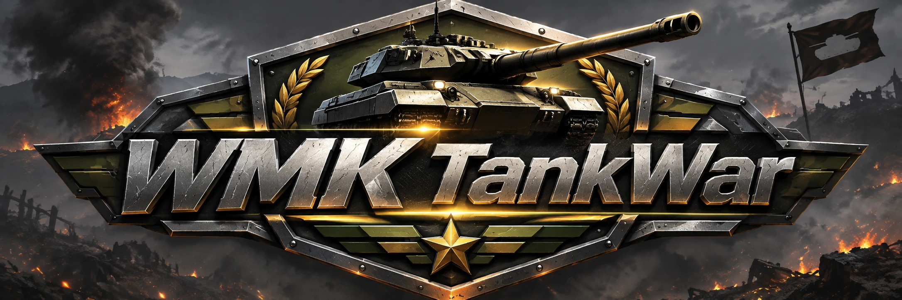

# 🛡️ WMK TankWar


Jogo independente de combate entre blindados, inspirado nas mecânicas de World of Tanks e War Thunder, com identidade própria, interface em português e foco em computadores modestos.

**Autor:** Walney Moreira Klein — walneyk@hotmail.com  
**GitHub:** [WalneyNF](https://github.com/WalneyNF)

## Objetivos

Desenvolver um jogo de blindados extensível, com progressão tecnológica, personalização de veículos, batalhas contra bots e ferramentas para criação de conteúdo.

## Base do protótipo

A versão desenvolvida localmente utiliza HTML, CSS, JavaScript e Canvas 2D, com:

- 20 blindados fictícios em cinco classes: leves, médios, pesados, caça-tanques e AAP.
- Quatro tiers, pesquisa, créditos e experiência.
- Hangar, compra de veículos e melhorias de módulos.
- Combate arcade, mira telescópica e modo de artilharia.
- Progresso salvo no navegador.
- Interface Workspace com painéis móveis, redimensionáveis e layouts personalizáveis, sujeita a testes.

**Estado do repositório:** protótipo v1.1 publicado; validação interativa pendente.

## Como executar

Baixe o projeto pelo botão Code > Download ZIP, extraia os arquivos e abra o index.html no navegador. Alternativamente, utilize o Live Server do VS Code ou o XAMPP.

```bash
git clone https://github.com/WalneyNF/WMK-TankWar.git
```

### Controles do protótipo

| Controle | Ação |
|---|---|
| W/A/S/D | Movimentação |
| Mouse | Apontar |
| Clique / Espaço | Disparar |
| 1 / 2 / 3 | Alternar modo de mira |

## Roadmap

- [x] Publicar o protótipo existente.
- [ ] Validar o protótipo no navegador.
- [ ] Consolidar painéis móveis, fechamento, encaixe, redimensionamento e layouts JSON.
- [ ] Aprimorar hangar e árvore tecnológica por nação, classe e tier.
- [ ] Separar os dados em arquivos JSON individuais por veículo.
- [ ] Criar editor de blindados e laboratório de parâmetros.
- [ ] Implementar hangar 3D com Three.js e modelos GLB.
- [ ] Criar campo de treinamento, editor de mapas e editor de missões.
- [ ] Evoluir bots, equipes, minimapa e modos de jogo.
- [ ] Implementar carreira, estatísticas e progressão avançada.
- [ ] Documentar a arquitetura e publicar versões para testes.

## Contribuições

Sugestões, relatos de erros e melhorias são bem-vindos nas Issues. Informe a versão utilizada, navegador, passos para reproduzir o problema e mensagens do console, quando disponíveis.

## Licença

O código original deste projeto é distribuído sob a [licença MIT](LICENSE). Recursos de terceiros devem respeitar suas respectivas licenças.

World of Tanks e War Thunder são referências de gênero; WMK TankWar não possui vínculo oficial com seus desenvolvedores e não reivindica direitos sobre suas marcas ou recursos.

© 2026 Walney Moreira Klein.

## Documentação HTML

- [Roadmap](roadmap.html)
- [Manual de primeiro contato](manuais/manual.html)
- [Arquitetura e diagnóstico](manuais/arquitetura.html)
